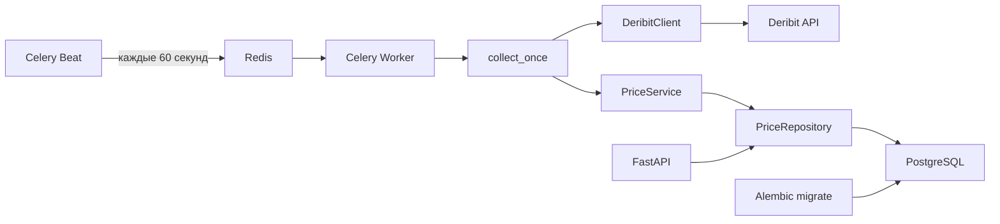

# Deribit Price Tracker

Python 3.12 сервис собирает индексные цены `btc_usd` и `eth_usd` из публичного
API Deribit каждую минуту, сохраняет их в PostgreSQL и отдаёт историю через
FastAPI. Для запуска всей системы достаточно Docker Compose.

## Стек

FastAPI, Pydantic v2, aiohttp, SQLAlchemy 2, PostgreSQL, Alembic, Celery Beat,
Celery Worker, Redis, pytest и Ruff.

## Архитектура



`collect_once` создаёт и закрывает HTTP-сессию, SQLAlchemy Session и Engine для
одного цикла. `PriceService` запрашивает обе цены параллельно и сохраняет
успешные результаты одной транзакцией с общим UNIX timestamp в секундах UTC.
API только читает сохранённые данные и не обращается к Deribit.

## Запуск через Docker Compose

Нужны Docker Desktop и Docker Compose. Команды PowerShell выполняются из корня
клонированного репозитория:

```powershell
Copy-Item .env.example .env
```

В `.env` задайте локальный пароль вместо `CHOOSE_A_LOCAL_PASSWORD` одновременно
в `POSTGRES_PASSWORD` и `DATABASE_URL`. Для простого URL используйте пароль без
символов `@`, `:`, `/`, `#`; иначе закодируйте его в `DATABASE_URL`. `.env`
игнорируется Git и исключён из Docker-образа.

```powershell
docker compose up -d --build
docker compose ps -a
```

Compose запускает PostgreSQL и Redis, выполняет `alembic upgrade head` в
одноразовом сервисе `migrate`, затем запускает API, Worker и Beat. Нормальное
состояние `migrate` — `Exited (0)`. Миграции применяются повторно безопасно;
именованный том PostgreSQL сохраняет ранее записанные цены. Первые новые
котировки появятся примерно через минуту после запуска Beat.

- API: <http://localhost:8000>
- Swagger UI: <http://localhost:8000/docs>
- OpenAPI: <http://localhost:8000/openapi.json>
- Проверка HTTP-приложения: <http://localhost:8000/health>

`/health` проверяет только HTTP-приложение, а не доступность PostgreSQL, Redis
или Deribit. Логи и последние сохранённые записи:

```powershell
docker compose logs -f api worker beat migrate
docker compose exec postgres psql -U tracker -d deribit_prices -c "SELECT id, ticker, price, timestamp FROM prices ORDER BY timestamp DESC, id DESC LIMIT 10"
```

Для остановки без удаления цен:

```powershell
docker compose down
docker desktop stop
```

Не используйте `docker compose down -v` для обычной остановки: флаг `-v`
удаляет том PostgreSQL. Контейнерам не задан автоматический перезапуск.

### Настройки окружения

| Переменная | Назначение |
| --- | --- |
| `POSTGRES_USER`, `POSTGRES_PASSWORD`, `POSTGRES_DB`, `POSTGRES_PORT` | Локальная БД и опубликованный только на `127.0.0.1` порт. |
| `DATABASE_URL` | URL для локальных Alembic, API и ручного сбора. В контейнерах Compose подставляет hostname `postgres`. |
| `CELERY_BROKER_URL` | URL брокера; в контейнерах Compose использует hostname `redis`. Redis наружу не публикуется. |
| `DERIBIT_API_BASE_URL` | Базовый URL публичного API Deribit. |
| `HTTP_TIMEOUT_SECONDS` | Таймаут одной HTTP-попытки (по умолчанию 5 секунд). |
| `APP_NAME`, `LOG_LEVEL` | Название FastAPI и уровень логирования. |

Пример без реальных секретов находится в `.env.example`.

## HTTP API

Все методы требуют query-параметр `ticker`: только `btc_usd` или `eth_usd`.
Цены в JSON представлены строками для сохранения десятичной точности.

| Метод | Описание |
| --- | --- |
| `GET /api/v1/prices?ticker=btc_usd&limit=100&offset=0` | История по тикеру, `timestamp DESC, id DESC`. |
| `GET /api/v1/prices/latest?ticker=eth_usd` | Последняя сохранённая цена. |
| `GET /api/v1/prices/by-date?ticker=btc_usd&date=2026-10-14&limit=100&offset=0` | Цены за календарный день UTC. |

`limit` по умолчанию 100, допустимы значения 1–1000; `offset` по умолчанию 0,
допустимы неотрицательные значения. Пагинация выполняется в SQL, без загрузки
всей истории. Параметр `date` обязателен в формате `YYYY-MM-DD`: интервал
`start_ts <= timestamp < start_ts + 86400` включает начало дня UTC и исключает
начало следующего. Локальный часовой пояс не используется.

Примеры запросов:

```powershell
Invoke-RestMethod 'http://localhost:8000/api/v1/prices?ticker=btc_usd&limit=2'
Invoke-RestMethod 'http://localhost:8000/api/v1/prices/latest?ticker=eth_usd'
Invoke-RestMethod 'http://localhost:8000/api/v1/prices/by-date?ticker=btc_usd&date=2026-10-14'
```

Пример ответа списка (значения иллюстративные):

```json
{
  "items": [
    {"id": 7, "ticker": "btc_usd", "price": "83183.89000000", "timestamp": 1791972641}
  ],
  "limit": 2,
  "offset": 0
}
```

`/latest` возвращает одну запись того же вида без `items`, `limit` и `offset`.
Пустая история или дата дают HTTP 200 и `items: []`; отсутствие последней цены
даёт 404. Некорректные `ticker`, `date`, `limit` и `offset` дают 422. Ошибка БД
даёт 500 без SQL-трассировки или DSN в ответе.

## Локальная разработка и проверки

Проект можно запускать вне Docker. Для локального API нужен PostgreSQL и
применённая миграция:

```powershell
py -3.12 -m venv .venv
.\.venv\Scripts\python.exe -m pip install -e ".[dev]"
Copy-Item .env.example .env
docker compose up -d postgres
.\.venv\Scripts\python.exe -m alembic upgrade head
.\.venv\Scripts\python.exe -m uvicorn app.main:app --reload
```

После настройки `.env` один ручной цикл сбора запускается командой
`.\.venv\Scripts\python.exe -m app.collect_once`. Она завершается после одного
цикла и не запускает Beat. Миграции никогда не выполняются при импорте модулей.

```powershell
.\.venv\Scripts\python.exe -m pytest
.\.venv\Scripts\python.exe -m ruff check .
.\.venv\Scripts\python.exe -m ruff format --check .
.\.venv\Scripts\python.exe -m pip check
```

Тесты клиента и Celery не требуют реального Deribit, Redis или PostgreSQL.
Тесты Repository, Service и HTTP API используют изолированную SQLite БД.

## Структура проекта

| Путь | Ответственность |
| --- | --- |
| `app/api/` | Маршруты и Pydantic-схемы HTTP API. |
| `app/core/` | Настройки, фабрика FastAPI, зависимости запросов. |
| `app/services/` | Логика одного цикла сбора и транзакция. |
| `app/repositories/` | Чтение и запись цен через SQLAlchemy. |
| `app/infrastructure/` | Deribit HTTP-клиент, Engine, ORM-модель. |
| `app/tasks/`, `app/celery_worker.py` | Фабрика Celery, расписание и задача. |
| `app/collect_once.py` | Общая функция сбора и ручная точка входа. |
| `alembic/` | Миграция схемы PostgreSQL. |
| `tests/` | Автоматические тесты. |

## Design decisions

| Решение | Причина и ограничение |
| --- | --- |
| FastAPI | Даёт валидацию query-параметров и Swagger/OpenAPI для публичного GET API. |
| Repository и Dependency Injection | Отделяют SQL-запросы от HTTP и сбора. FastAPI создаёт Engine в lifespan, Session — на запрос через `Depends`; ручной и фоновый сбор передают зависимости явно. |
| PostgreSQL и Alembic | Постоянное хранение цен и управляемые изменения схемы. Отдельный сервис `migrate` завершает миграцию до старта API и Worker. |
| `Decimal` / `NUMERIC(20,8)` | Не теряют десятичную точность; JSON отдаёт цену строкой. |
| UNIX timestamp UTC в `BIGINT` | Секунды UTC соответствуют заданию и не ограничены 32-битным диапазоном. Один timestamp используется для обеих цен цикла. |
| Индекс `(ticker, timestamp)` | Поддерживает выборки истории по тикеру и времени. При равном timestamp порядок уточняется `id DESC`. |
| Celery Beat + Redis + Worker | Beat публикует `prices.collect` каждые 60 секунд, Redis передаёт задачу, Worker выполняет существующий `collect_once`. Сервисы можно запускать и проверять отдельно. |
| Отдельные Docker-сервисы | PostgreSQL, Redis, миграция, API, Worker и Beat имеют разные жизненные циклы при одном образе приложения. |
| Частичный успех BTC/ETH | Ошибка одного запроса не теряет удачную цену второго. Два отказа или ошибка БД отмечают Celery-задачу как неуспешную. |
| Пагинация | Ограничивает объём ответа и число строк, считываемых из БД. `total` отдельным запросом не вычисляется. |
| Ограничения повторов и дубликатов | HTTP-клиент делает не более трёх попыток на тикер; Celery не повторяет задачу автоматически. `expires=50` секунд, лимит выполнения 45 секунд и один Worker с `concurrency=1` снижают риск накопления задач, но не гарантируют идемпотентность при повторной доставке или нескольких Worker. |

Отдельная domain-сущность и распределённая блокировка не нужны для текущего
объёма задания.
